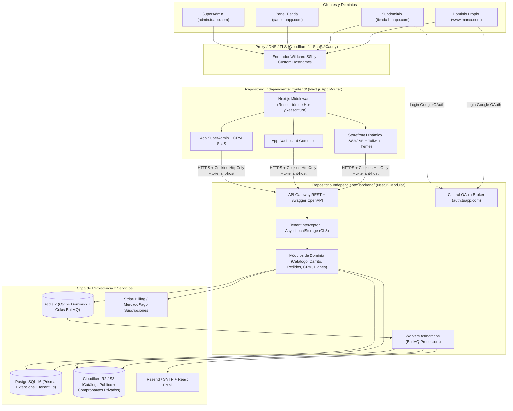
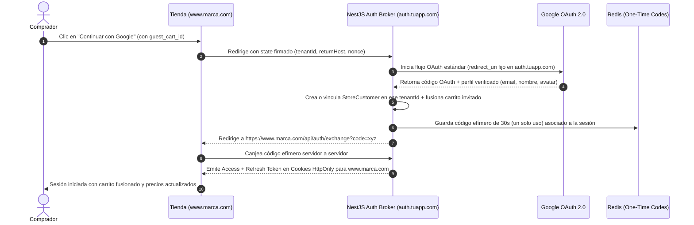
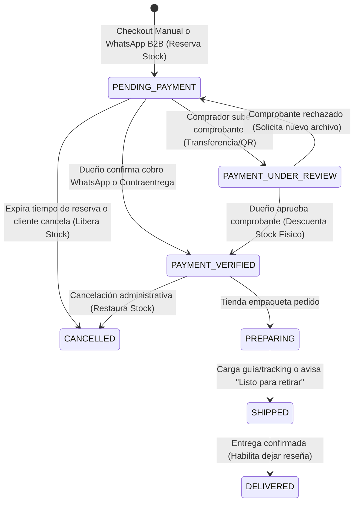
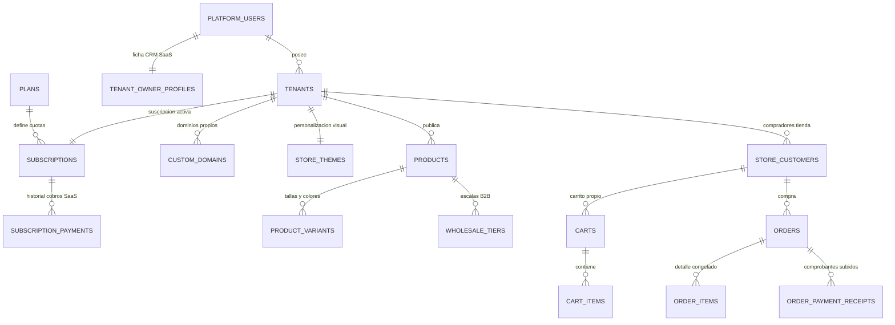

# Plan Maestro de Ingeniería y Producto: Plataforma SaaS E-Commerce Multi-Tienda (B2C + Mayorista B2B)

> [!IMPORTANT]
> **Resumen de Decisiones Estratégicas Consolidadas**
> * **Modelo de Negocio**: **SaaS Multi-Tienda Puro** donde vendes/alquilas tiendas online independientes mediante **planes de suscripción mensual/anual** (cobro automático con Stripe/MercadoPago + activación manual por transferencia).
> * **Enfoque Comercial Dual**: Soporte nativo para **Venta Minorista (B2C)** con variantes físicas y envíos + **Catálogo Mayorista (B2B)** con precios escalonados por cantidad, compra mínima y cierre formal conectado a WhatsApp.
> * **Arquitectura**: Repositorios/carpetas independientes (`backend/` en **NestJS** y `frontend/` en **Next.js App Router + Tailwind CSS + shadcn/ui**), subdominios automáticos (`tienda.tudominio.com`) + dominios propios (`www.cliente.com`), PostgreSQL con aislamiento por `tenant_id`, Redis + BullMQ, S3/Cloudflare R2 y Auth 100% propia (Google OAuth + Email) con correos transaccionales vía React Email + Resend.
> * **Capacidad Base**: 1 Desarrollador Full-Stack (apoyado con IA) a tiempo completo (`35–40 h/semana`), estructurado en **6 Fases (16 semanas)** con **Hito MVP Comercial Vendible en la Semana 11**.

---

## 1. Visión del Producto, Actores y Esquema de Planes SaaS

### 1.1 Actores del Ecosistema
1. **SuperAdmin de Plataforma (Tú)**: Administra el negocio SaaS, gestiona planes, aprueba pagos manuales de suscripción, audita consumo de cuotas, suspende tiendas morosas y administra el **CRM completo de clientes dueños de tienda**.
2. **Dueño de Tienda / Staff (`Store Owner` / `Store Staff`)**: Cliente suscrito a tu plataforma. Configura la estética de su tienda, gestiona catálogo B2C/B2B, importa Excel/CSV, valida comprobantes de pago de sus compradores, despacha pedidos y revisa reportes.
3. **Comprador Minorista (`Retail Customer`)**: Se registra con Google o Email dentro de una tienda específica, posee su **propio carrito persistente en esa tienda**, guarda direcciones, aplica cupones, sube comprobantes de transferencia/QR y deja reseñas.
4. **Comprador Mayorista (`Wholesale B2B Customer`)**: Accede a tramos de descuento por volumen, cumple reglas de compra mínima y puede cerrar pedidos formales con stock reservado directo hacia el WhatsApp comercial de la tienda o mediante transferencia.
5. **Visitante Invitado (`Guest`)**: Navega la tienda y arma su carrito temporal; al iniciar sesión con Google o Email, el sistema fusiona automáticamente su carrito invitado con su cuenta.

### 1.2 Estructura Sugerida de Planes SaaS (Controlados por `PlanQuotaGuard` en NestJS)

| Característica / Cuota Técnica | Plan Emprendedor (Inicial) | Plan Crecimiento (Pro) | Plan Mayorista / Enterprise |
| :--- | :--- | :--- | :--- |
| **Dominio de Tienda** | Subdominio `tienda.tuapp.com` | Subdominio + **Dominio Propio** | Subdominio + **Dominio Propio** |
| **Límite de Productos Activos** | Hasta 100 productos | Hasta 1,500 productos | Ilimitados |
| **Cuentas de Equipo (Staff)** | 1 (Dueño) | Hasta 3 usuarios | Hasta 10 usuarios |
| **Modo Mayorista B2B (Tramos + WhatsApp)** | Básico | Completo (escalas por variante) | Completo + listas especiales |
| **Importación Masiva Excel / CSV** | No incluido | Incluido (hasta 2,000 filas/lote) | Incluido (lotes extendidos) |
| **Recuperación de Carritos Abandonados** | No incluido | Automático por Email (BullMQ) | Automático + Cupón dinámico |
| **Cupones, Favoritos y Reseñas** | Cupones básicos | Completo | Completo + Reportes avanzados |

---

## 2. Arquitectura del Sistema y Stack Tecnológico

### 2.1 Diagrama General de Arquitectura (`backend/` y `frontend/` Independientes)



### 2.2 Organización de Repositorios Independientes y Contrato Tipado

> [!TIP]
> **Tipado de extremo a extremo sin usar Monorepo**: El backend NestJS expondrá su especificación OpenAPI 3.1 mediante `@nestjs/swagger` (`/api/docs-json`). En el repositorio `frontend/`, un script `npm run sync:api` ejecutará `openapi-typescript` para autogenerar las interfaces exactas de todos los DTOs y respuestas en segundos.

#### Estructura del Repositorio `backend/` (NestJS)
```text
backend/
├── prisma/
│   ├── schema.prisma              # Esquema relacional completo con índices (tenant_id, ...)
│   ├── migrations/                # Migraciones versionadas
│   └── seed.ts                    # Planes base, usuario SuperAdmin y tienda demo
├── src/
│   ├── common/
│   │   ├── cls/                   # AsyncLocalStorage para propagar tenantId y userId
│   │   ├── decorators/            # @CurrentTenant(), @CurrentUser(), @RequirePlanFeature()
│   │   ├── guards/                # JwtAuthGuard, RolesGuard, TenantStatusGuard, PlanQuotaGuard
│   │   ├── interceptors/          # TenantResolutionInterceptor, AuditLogInterceptor
│   │   └── filters/               # GlobalExceptionFilter estandarizado (RFC 7807)
│   ├── database/
│   │   └── prisma.service.ts      # Prisma Client + $extends para inyección forzosa de tenant_id
│   ├── modules/
│   │   ├── auth/                  # Google OAuth Broker, Email/Password, OTP, Refresh Tokens
│   │   ├── platform-admin/        # SuperAdmin, métricas SaaS y CRM de dueños de tienda
│   │   ├── subscriptions/         # Planes, webhooks Stripe/MP, pagos manuales de suscripción
│   │   ├── tenants/               # Creación de tienda, subdominios, dominios propios, temas
│   │   ├── catalog/               # Categorías, productos, imágenes, variantes y SKUs
│   │   ├── wholesale/             # Escalas de precios por volumen B2B y mínimos de compra
│   │   ├── inventory/             # Control atómico de stock físico y stock reservado
│   │   ├── cart/                  # Carrito persistente por tienda, guest merge y cálculo en vivo
│   │   ├── coupons/               # Motor de descuentos y validaciones de uso
│   │   ├── orders/                # Máquina de estados, Checkout Manual y WhatsApp Checkout B2B
│   │   ├── payments-store/        # Métodos manuales por tienda y validación de comprobantes
│   │   ├── shipping/              # Zonas, tarifas, gratis desde X monto, retiro en sucursal
│   │   ├── customers/             # Perfil de compradores por tienda, direcciones y Wishlist
│   │   ├── reviews/               # Valoraciones 1-5 estrellas verificadas por compra entregada
│   │   ├── imports/               # Procesador CSV/Excel asíncrono con BullMQ
│   │   ├── abandoned-carts/       # Cron/Worker BullMQ detector y recuperador por email
│   │   ├── storage/               # Presigned URLs para S3 / Cloudflare R2
│   │   └── notifications/         # Plantillas React Email + cola de despacho Resend/SMTP
│   └── main.ts                    # Bootstrap, Helmet, CORS dinámico multi-dominio, Swagger
└── docker-compose.yml             # PostgreSQL 16 + Redis 7 + MinIO (S3 local)
```

#### Estructura del Repositorio `frontend/` (Next.js App Router)
```text
frontend/
├── src/
│   ├── middleware.ts              # Detecta hostname (admin, panel, subdominio o dominio propio)
│   ├── app/
│   │   ├── (marketing)/           # Landing page comercial para vender tu SaaS y planes
│   │   ├── (superadmin)/          # Panel SuperAdmin: CRM clientes SaaS, planes, cobros, tiendas
│   │   ├── (dashboard)/           # Panel Dueño de Tienda: catálogo, pedidos, diseño, CSV, envíos
│   │   └── store/[domain]/        # Storefront público de cada tienda (SSR para SEO + Carrito)
│   ├── components/
│   │   ├── ui/                    # Componentes base shadcn/ui accesibles
│   │   ├── storefront/            # Navbar dinámica, galería, tabla B2B, drawer de carrito
│   │   └── dashboard/             # Tablas TanStack, editor de tema en vivo, visor de comprobantes
│   ├── lib/
│   │   ├── api-client.ts          # Cliente fetch tipado con openapi-typescript + refresh automático
│   │   └── theme-engine.ts        # Inyección de variables CSS dinámicas por tienda
│   └── stores/
│       └── cart-ui.store.ts       # Estado optimista del drawer de carrito sincronizado con API
└── tailwind.config.ts
```

---

## 3. Diseño Profundo de Mecanismos Críticos en NestJS

### 3.1 Aislamiento Multi-Tenant Blindado (Cero Fuga de Datos)
1. **Resolución de Tienda**: `Next.js Middleware` extrae el `Host` entrante (`zapateria.tuapp.com` o `www.zapaterialopez.com`) y lo envía a NestJS en la cabecera verificada `x-tenant-host`.
2. **Caché Ultrarrápida**: `TenantResolutionInterceptor` consulta Redis (`tenant:host:{hostname}`, TTL 10 min). Si no está en caché, busca en PostgreSQL (`tenants` o `custom_domains`), verifica que la suscripción no esté suspendida y guarda el contexto en `AsyncLocalStorage` (`nestjs-cls`).
3. **Candado Automático en ORM**: Mediante **Prisma Client Extensions (`$extends`)**, toda consulta sobre tablas con alcance de tienda inyecta obligatoriamente `where: { tenantId: cls.get('tenantId') }`. Incluso si un desarrollador olvida filtrar por tienda en un servicio, el cliente de base de datos bloquea cualquier lectura o escritura cruzada.

### 3.2 Flujo de Autenticación Google OAuth 2.0 + Email en Subdominios y Dominios Propios
Google Cloud Console no admite URLs de retorno con comodines (`https://*.tuapp.com/callback`). Para soportarlo en cientos de subdominios y dominios propios sin pedir configuración técnica a tus clientes, implementaremos un **Central OAuth Broker**:



### 3.3 Ciclo de Vida del Pedido, Pagos Manuales y WhatsApp B2B
Cada cambio de estado ocurre dentro de una transacción de base de datos, registra auditoría en `order_status_history` y encola en `BullMQ` el correo correspondiente con el branding de esa tienda:



---

## 4. Modelo de Datos Relacional (PostgreSQL + Prisma)



### Tablas Clave por Dominio
1. **Gobierno SaaS y CRM SuperAdmin**:
   * `plans`: `id`, `code`, `name`, `price_monthly`, `price_yearly`, `max_products`, `max_staff`, `allow_custom_domain`, `allow_csv_import`, `allow_abandoned_cart`, `allow_wholesale`.
   * `platform_users`: cuentas de administradores SaaS, dueños de tienda y empleados (`email`, `password_hash`, `google_id`, `role`, `email_verified_at`).
   * `tenant_owner_profiles` (**CRM de tus clientes**): `user_id`, `legal_name`, `tax_id` (RUC/DNI/NIT), `phone_whatsapp`, `country`, `city`, `fiscal_address`, `business_category`, `acquisition_source`, `internal_admin_notes`, `onboarding_completed`.
   * `tenants`: `id`, `slug` (subdominio), `name`, `status` (`TRIAL`, `ACTIVE`, `PAST_DUE`, `SUSPENDED`), `whatsapp_sales_number`, `currency`, `min_wholesale_amount`, `min_wholesale_qty`.
   * `subscriptions` & `subscription_payments`: control de ciclo de facturación, proveedor (`STRIPE`, `MERCADOPAGO`, `MANUAL_TRANSFER`), URL del comprobante SaaS y fechas de corte.
2. **Catálogo Minorista + Mayorista B2B**:
   * `store_themes`: `tenant_id`, `logo_url`, `favicon_url`, `primary_color`, `accent_color`, `dark_mode_default`, `hero_banners` (JSONB), ` typography`.
   * `categories`, `products` (`is_wholesale_only`, `min_order_qty`), `product_images`.
   * `product_variants`: `id`, `tenant_id`, `product_id`, `sku`, `attributes` (ej. `{"talla":"M","color":"Negro"}`), `retail_price`, `compare_at_price`, `stock_on_hand`, `stock_reserved`, `weight_grams`.
   * `wholesale_tiers`: `id`, `tenant_id`, `product_id` (o `variant_id`), `min_quantity`, `max_quantity`, `unit_price` (ej. 1–5: 25 USD, 6–23: 19 USD, 24+: 15 USD).
3. **Compradores, Carrito Propio, Favoritos y Reseñas**:
   * `store_customers`: `id`, `tenant_id`, `email`, `password_hash`, `google_id`, `full_name`, `phone`, `customer_tier` (`RETAIL`, `WHOLESALE_B2B`), `total_orders`, `total_spent` — restricción única `UNIQUE(tenant_id, email)`.
   * `customer_addresses`: múltiples direcciones guardadas por comprador en esa tienda.
   * `carts` & `cart_items`: `tenant_id`, `customer_id` (nullable para invitados), `guest_token`, `coupon_id`, `status` (`ACTIVE`, `CONVERTED`, `ABANDONED`), `abandoned_email_sent_at`, `last_activity_at`.
   * `wishlists` & `product_reviews` (`rating` 1..5, `comment`, `order_id` verificado, `is_published`).
4. **Checkout, Comprobantes y Envíos**:
   * `coupons`: `code`, `discount_type` (`PERCENTAGE`, `FIXED`), `value`, `min_purchase`, `max_uses`, `used_count`, `expires_at`.
   * `shipping_zones`: `name`, `cities` (array), `flat_rate`, `free_shipping_threshold`, `is_local_pickup`, `pickup_address`.
   * `store_payment_methods`: configuración de cuentas bancarias, imagen QR, instrucciones de Pago Móvil o Contraentrega de cada tienda.
   * `orders`, `order_items` (congela nombre, SKU, precio unitario aplicado y tramo B2B al momento de compra), `order_payment_receipts` (`file_key` privado en S3/R2, `reference_number`, `reviewed_by`, `review_status`), `order_status_history`.

---

## 5. Levantamiento de Requisitos Funcionales y No Funcionales

### 5.1 Requisitos Funcionales (RF)

| Código | Módulo | Descripción del Requisito Funcional | Prioridad |
| :--- | :--- | :--- | :--- |
| **RF-PLAT-01** | SuperAdmin CRM | Registrar y consultar la ficha integral de cada cliente dueño de tienda (identificación fiscal, contacto, rubro, notas internas, tiendas activas e historial de pagos). | Must |
| **RF-PLAT-02** | Planes SaaS | Crear/editar planes de suscripción definiendo límites numéricos y banderas de módulos (CSV, dominio propio, B2B, carritos abandonados). | Must |
| **RF-PLAT-03** | Suscripciones | Procesar cobros recurrentes vía webhooks (Stripe/MercadoPago) y permitir activación/renovación manual adjuntando comprobante de pago al SuperAdmin. | Must |
| **RF-PLAT-04** | Estado de Tienda | Suspender automáticamente el panel o cambiar la tienda a modo lectura/mantenimiento tras vencer el período de gracia de la suscripción. | Must |
| **RF-AUTH-01** | Auth Híbrida | Permitir registro e inicio de sesión tanto con **Google OAuth 2.0** (vía Broker central) como con **Email + Contraseña** para dueños de tienda y compradores. | Must |
| **RF-AUTH-02** | Verificación Email | Enviar código OTP o enlace firmado de verificación de email y recuperación de contraseña con expiración corta. | Must |
| **RF-STORE-01** | Multi-Dominio | Asignar automáticamente un subdominio único (`slug.tuapp.com`) al crear la tienda y permitir vincular un dominio personalizado en planes habilitados. | Must |
| **RF-STORE-02** | Personalizador | Configurar logo, paleta de colores, modo claro/oscuro, banners promocionales, redes sociales y número de WhatsApp de ventas con vista previa. | Must |
| **RF-CAT-01** | Productos y Variantes | Gestionar categorías jerárquicas, productos con galería múltiple ordenable y variantes combinables (talla, color, material) con SKU y stock propio. | Must |
| **RF-CAT-02** | Precios B2B | Definir tablas de precios escalonados por cantidad en productos/variantes y reglas de compra mínima mayorista (por unidades o monto). | Must |
| **RF-CAT-03** | Importador CSV | Importar y actualizar masivamente productos, stock y precios mediante plantillas Excel/CSV en segundo plano con reporte detallado de filas fallidas. | Should |
| **RF-CART-01** | Carrito Propio | Mantener un carrito persistente independiente para cada cliente dentro de cada tienda, fusionando automáticamente el carrito de invitado al iniciar sesión. | Must |
| **RF-CART-02** | Recálculo en Vivo | Recalcular instantáneamente en el carrito el precio unitario según la cantidad acumulada (tramos B2B), cupones vigentes y umbral de envío gratis. | Must |
| **RF-CART-03** | Carrito Abandonado | Detectar carritos activos sin actividad tras `X` horas de clientes con email conocido y enviar recordatorio automatizado con enlace directo de retorno. | Should |
| **RF-ORD-01** | Pagos Manuales | Permitir al comprador elegir transferencia, QR, Pago Móvil o efectivo, ver los datos de la tienda y subir imagen/PDF del comprobante de pago. | Must |
| **RF-ORD-02** | WhatsApp B2B | Generar un pedido formal en el sistema (reservando stock temporalmente) y abrir WhatsApp con el desglose exacto de ítems, descuentos por volumen y código de orden. | Must |
| **RF-ORD-03** | Flujo de Estados | Gestionar el ciclo `Pendiente` → `En revisión` → `Pago verificado` → `Preparando` → `Enviado (con guía)` → `Entregado` / `Cancelado`, notificando cada paso por email. | Must |
| **RF-SHIP-01** | Envíos por Tienda | Configurar costos de envío por zona/ciudad, regla de envío gratuito por monto mínimo y puntos de retiro gratis en local. | Must |
| **RF-MKT-01** | Conversión Social | Soportar cupones de descuento validados en servidor, lista de productos favoritos (Wishlist) por comprador y reseñas verificadas post-entrega. | Should |

### 5.2 Requisitos No Funcionales (RNF) — Estándares de "Backend Fuerte"
* **RNF-01 Aislamiento de Datos**: Imposibilidad arquitectónica de consultar registros sin `tenant_id` en entidades multi-tienda (`Prisma Extensions` + tests automatizados de aislamiento cruzado).
* **RNF-02 Integridad Transaccional de Inventario**: Operaciones de reserva, confirmación y devolución de stock ejecutadas con bloqueos optimistas/atómicos en PostgreSQL para soportar compras simultáneas sin stock negativo.
* **RNF-03 Seguridad de API y Sesiones**: Hashing `Argon2id`, cookies `HttpOnly + Secure + SameSite=Lax`, rotación de Refresh Tokens con invalidación de familia ante robo, validación estricta con `class-validator` (`whitelist: true, forbidNonWhitelisted: true`), `Helmet` y `@nestjs/throttler` (Rate Limiting en login, OTP y checkout).
* **RNF-04 Privacidad de Archivos**: Fotos de catálogo servidas vía CDN público, pero **comprobantes bancarios y documentos fiscales** privados y accesibles únicamente mediante *Presigned URLs* temporales de 5 minutos para usuarios autorizados.
* **RNF-05 Rendimiento y SEO**: Storefront renderizado con SSR/ISR en Next.js + metadatos OpenGraph dinámicos por producto/tienda; resolución de dominio cacheada en Redis en `< 5 ms`; API P95 `< 200 ms`.
* **RNF-06 Resiliencia Asíncrona**: Ningún request HTTP espera al servidor de correo ni al parseo de un Excel; todo pasa por colas `BullMQ` persistidas en Redis con reintentos exponenciales y *Dead Letter Queue*.
* **RNF-07 Observabilidad**: Logs JSON estructurados con `nestjs-pino` incluyendo `requestId` y `tenantId` en cada línea, monitoreo de excepciones con Sentry y endpoint `/health` con `@nestjs/terminus`.

---

## 6. Épicas e Historias de Usuario Clave (con Criterios de Aceptación)

### Épica 1: Gobierno SaaS, Planes y CRM de Clientes Dueños de Tienda
* **HU-01 (Alta y Ficha CRM de Cliente SaaS)**: *Como SuperAdmin, quiero ver y editar la ficha completa de cada cliente dueño de tienda (datos legales/RUC/DNI, WhatsApp, plan, historial de pagos, consumo de productos y notas internas) para llevar control comercial y soporte personalizado.*
  * **CA**: Muestra barra de uso (`productos actuales / máximo del plan`), estado de cuenta al día/vencido y bitácora de notas fechadas.
* **HU-02 (Gestión de Planes y Cuotas)**: *Como SuperAdmin, quiero configurar planes mensuales/anuales con límites de productos y funciones activables para segmentar mi oferta comercial.*
  * **CA**: Si una tienda intenta crear el producto `N+1` superando su plan, NestJS responde `403 PlanQuotaExceeded` con sugerencia clara de upgrade.
* **HU-03 (Cobro Automático y Manual de Suscripciones)**: *Como Dueño de Tienda, quiero pagar mi suscripción con tarjeta automática o subiendo transferencia al SuperAdmin para activar o subir de nivel mi tienda.*
  * **CA**: Webhook idempotente activa el plan al instante; en pago manual, el SuperAdmin aprueba en 1 clic y dispara email de bienvenida/recibo.
* **HU-04 (Suspensión por Mora con Gracia)**: *Como Sistema, quiero dar 5 días de gracia con avisos por email antes de pausar una tienda impaga para proteger la relación con el comercio sin regalar servicio indefinido.*
* **HU-05 (Métricas Globales SaaS)**: *Como SuperAdmin, quiero visualizar MRR (ingreso mensual recurrente), tiendas nuevas, tiendas activas vs en riesgo y volumen total de órdenes procesadas.*

### Épica 2: Autenticación (Google + Email), Seguridad y Onboarding
* **HU-06 (Registro y Login con Google OAuth Multi-Dominio)**: *Como Dueño de Tienda o Comprador, quiero iniciar sesión con un clic usando mi cuenta de Google tanto en el panel como en cualquier subdominio o dominio propio de tienda.*
  * **CA**: Funciona mediante el Auth Broker sin errores de `redirect_uri_mismatch` y vincula automáticamente cuentas existentes con el mismo email verificado en ese contexto.
* **HU-07 (Auth con Email, Verificación OTP y Recuperación)**: *Como Usuario, quiero registrarme con email y contraseña, verificar mi correo con código/enlace y recuperar mi acceso si olvido la clave.*
  * **CA**: Contraseñas hasheadas con Argon2id; límite de 5 intentos por minuto contra fuerza bruta.
* **HU-08 (Aislamiento de Compradores entre Tiendas)**: *Como Comprador, quiero que mi cuenta y carrito en la Tienda A sean independientes de la Tienda B para que cada comercio gestione solo su propia cartera.*
* **HU-09 (Asistente Rápido de Creación de Tienda)**: *Como nuevo Cliente SaaS, quiero completar un onboarding en 3 pasos (datos comerciales, nombre/subdominio disponible en tiempo real y colores/logo) para tener mi tienda publicada en menos de 5 minutos.*

### Épica 3: Personalización Moderna de Tienda y Dominios
* **HU-10 (Editor Visual de Marca)**: *Como Dueño de Tienda, quiero personalizar logo, colores primario/secundario, modo claro/oscuro y banners hero desde mi panel para que mi tienda refleje una estética moderna y propia.*
* **HU-11 (Configuración de Dominio Propio)**: *Como Dueño de Tienda en Plan Pro, quiero conectar `www.mimarca.com` viendo las instrucciones DNS (CNAME/TXT) y el estado de emisión SSL en vivo.*
* **HU-12 (Gestión de Empleados / Staff)**: *Como Dueño de Tienda, quiero invitar colaboradores por email con permisos acotados (ej. solo ver pedidos y despachar, sin editar facturación SaaS).*

### Épica 4: Catálogo Físico B2C, Motor Mayorista B2B e Importador Masivo
* **HU-13 (Creación de Productos y Matriz de Variantes)**: *Como Dueño de Tienda, quiero crear productos con múltiples imágenes arrastrables y generar variantes automáticas (ej. Tallas S, M, L × Colores Blanco, Negro) con SKU, precio y stock individual.*
* **HU-14 (Precios Escalonados por Volumen B2B)**: *Como Dueño de Tienda Mayorista, quiero configurar tramos de precios por cantidad (ej. 1–5 uds, 6–11 uds, 12+ uds) y compra mínima para incentivar pedidos grandes.*
  * **CA**: En la página de producto se muestra una tabla clara de ahorro por volumen ("Lleva 12+ a X c/u — ahorras 25%").
* **HU-15 (Clasificación de Cliente Mayorista)**: *Como Dueño de Tienda, quiero poder marcar ciertos productos o listas de precios como visibles para todo público por volumen o exclusivos para compradores etiquetados como `Mayorista B2B`.*
* **HU-16 (Importación y Actualización Masiva CSV/Excel)**: *Como Dueño de Tienda con catálogo amplio, quiero descargar una plantilla Excel/CSV y subir cientos de productos o cambios de precio/stock de una sola vez.*
  * **CA**: Se procesa en `BullMQ` con barra de progreso en vivo y archivo descargable indicando exactamente qué fila tuvo error de formato.
* **HU-17 (Alertas de Stock Bajo)**: *Como Dueño de Tienda, quiero recibir alertas visuales en mi dashboard cuando una variante baje del umbral mínimo configurado.*

### Épica 5: Storefront Moderno, Carrito Inteligente, Favoritos y Reseñas
* **HU-18 (Exploración Ultrarrápida y Filtros)**: *Como Comprador, quiero buscar productos con autocompletado y filtrar por categoría, rango de precio, atributos (talla/color) y disponibilidad con diseño móvil impecable.*
* **HU-19 (Carrito Propio Persistente y Fusión Invitado)**: *Como Comprador, quiero agregar variantes a mi carrito sin estar logueado y que, al iniciar sesión con Google o Email, mis productos se conserven y combinen con mi carrito guardado.*
* **HU-20 (Recálculo Mayorista y Umbral de Envío en Carrito)**: *Como Comprador, quiero ver en mi drawer de carrito cómo baja el precio unitario al aumentar cantidades y cuánto me falta para alcanzar la compra mínima o el envío gratis.*
* **HU-21 (Cupones y Lista de Favoritos / Wishlist)**: *Como Comprador registrado, quiero guardar productos en mis Favoritos y aplicar códigos promocionales en mi carrito.*
* **HU-22 (Reseñas Verificadas)**: *Como Comprador que recibió su pedido (`DELIVERED`), quiero calificar de 1 a 5 estrellas y comentar el producto para generar confianza en la tienda.*

### Épica 6: Checkout, Pagos Manuales, WhatsApp B2B, Envíos y Despacho
* **HU-23 (Configuración de Tarifas de Envío y Retiro)**: *Como Dueño de Tienda, quiero definir tarifas de envío por ciudad/zona, monto para envío gratuito y sucursales de retiro sin costo.*
* **HU-24 (Checkout con Pago Manual y Carga de Comprobante)**: *Como Comprador, quiero elegir Transferencia, QR, Pago Móvil o Contraentrega, ver los datos de pago de la tienda y subir mi captura/PDF del comprobante.*
  * **CA**: La orden nace en `PENDING_PAYMENT` o `PAYMENT_UNDER_REVIEW`, reserva el stock y notifica al vendedor por email.
* **HU-25 (Checkout Mayorista / Cierre por WhatsApp)**: *Como Comprador Mayorista, quiero finalizar mi carrito con el botón "Generar Pedido y Coordinar por WhatsApp" para que quede registrado con número de orden y abra el chat con el resumen exacto.*
* **HU-26 (Bandeja de Validación de Pagos y Despacho)**: *Como Dueño de Tienda, quiero revisar el comprobante privado en mi panel, aprobar o rechazar con motivo, y luego cargar la empresa transportadora + número de guía.*
* **HU-27 (Historial y Seguimiento del Comprador)**: *Como Comprador, quiero entrar a "Mis Pedidos" en la tienda para ver en qué estado va mi compra, mi comprobante y mi código de rastreo.*

### Épica 7: Emails Transaccionales y Recuperación de Carritos Abandonados
* **HU-28 (Emails Transaccionales con Identidad de Marca)**: *Como Comprador, quiero recibir correos claros y modernos con el logo y nombre de la tienda donde compré en cada hito (registro, compra recibida, pago aprobado, pedido enviado).*
* **HU-29 (Motor Automático de Carritos Abandonados)**: *Como Dueño de Tienda en Plan Pro, quiero que el sistema envíe automáticamente un correo amigable a los clientes que dejaron ítems en su carrito hace más de 3 horas sin comprar, con un botón que reconstruya su sesión/carrito.*
  * **CA**: Nunca envía más de 1 recordatorio por ciclo de abandono y se cancela si el cliente ya completó la orden.
* **HU-30 (Panel de Carritos Abandonados)**: *Como Dueño de Tienda, quiero ver cuántos carritos abandonados se detectaron, cuántos se recuperaron y cuánto ingreso extra generaron.*

---

## 7. Plan de Ejecución por Fases y Tiempos (16 Semanas — 1 Full-Stack Dev + IA)

> [!NOTE]
> **Estrategia de Entrega Incremental**: No esperarás 4 meses para poder mostrar o vender el producto. Al finalizar la **Fase 4 (Semana 11)** ya tendrás un **MVP Comercial 100% funcional y vendible** (Multi-tienda con subdominios, Google/Email Auth, CRM SuperAdmin, Planes, Catálogo B2C + Mayorista B2B, Carrito propio, Pagos con comprobante, WhatsApp Checkout y Emails). Las **Fases 5 y 6 (Semanas 12–16)** agregan los potenciadores Pro (CSV masivo, carritos abandonados, cupones, reseñas y dominios propios con SSL).

### Resumen Ejecutivo del Cronograma

| Fase | Semanas | Nombre de la Fase | Hito Principal Entregable |
| :--- | :--- | :--- | :--- |
| **Fase 1** | Sem 1 – 3 | Cimientos, Núcleo Multi-Tenant NestJS y Auth (Google + Email) | Infra Docker, aislamiento `tenant_id`, Auth Broker OAuth + OTP y base Next.js + OpenAPI sync. |
| **Fase 2** | Sem 4 – 5 | SuperAdmin SaaS, CRM de Clientes y Motor de Planes | Panel SuperAdmin completo, ficha CRM de dueños de tienda, planes, cuotas y cobro de suscripciones. |
| **Fase 3** | Sem 6 – 8 | Panel de Tienda, Branding, Catálogo con Variantes y Precios B2B | Onboarding de tienda, editor de diseño, productos, variantes, stock, imágenes S3/R2 y escalas B2B. |
| **Fase 4** | Sem 9 – 11 | Storefront Moderno, Carrito Propio, Checkout Manual/WhatsApp y Envíos | **🚀 HITO MVP COMERCIAL**: Tiendas públicas vendiendo, carrito inteligente, comprobantes y emails. |
| **Fase 5** | Sem 12 – 14 | Crecimiento Pro: Importador CSV, Carritos Abandonados, Cupones y Social | Procesamiento masivo Excel/CSV, recuperación automática por BullMQ, cupones, favoritos y reseñas. |
| **Fase 6** | Sem 15 – 16 | Dominios Propios + SSL, Hardening de Seguridad, Tests E2E y Lanzamiento | Conexión `www.cliente.com`, auditoría OWASP, pruebas de concurrencia de stock, CI/CD y Producción. |

---

### Desglose Detallado Semana por Semana

#### Fase 1: Cimientos, Núcleo Multi-Tenant NestJS y Autenticación (Semanas 1 a 3)
* **Semana 1 — Setup de Repositorios, Docker, Prisma Multi-Tenant y OpenAPI**:
  * Inicialización de `backend/` (NestJS 11, Fastify/Express, Pino logger, ConfigModule validado con Zod) y `frontend/` (Next.js App Router, Tailwind CSS, shadcn/ui).
  * `docker-compose.yml` con PostgreSQL 16, Redis 7 y MinIO (compatible S3).
  * Configuración de `nestjs-cls` (`AsyncLocalStorage`) + `PrismaService.$extends` para aislamiento automático por `tenant_id` + caché de resolución de host en Redis.
  * Pipeline `Swagger` → `openapi-typescript` conectando ambos repositorios.
* **Semana 2 — Auth Nativa Robusta (Email + Google OAuth Broker)**:
  * Registro/Login Email + Password (`Argon2id`), emisión y rotación de `Refresh Tokens` en cookies `HttpOnly`, revocación de sesiones y Rate Limiting.
  * Implementación del **Central OAuth Broker** para Google OAuth 2.0 compatible con múltiples subdominios.
  * Separación de identidades `PlatformUser` (dueños/staff/superadmin) vs `StoreCustomer` (compradores por tienda).
* **Semana 3 — Motor de Correos Transaccionales y Pantallas de Acceso**:
  * Configuración de `BullMQ` en NestJS + servicio `NotificationsModule` con plantillas `React Email` (verificación OTP/Link, bienvenida, reseteo de clave) vía Resend/SMTP.
  * Pantallas modernas de Login, Registro, Verificación OTP y Recuperación de clave en `frontend/` (tanto para la plataforma SaaS como dinámicas por tienda).

#### Fase 2: SuperAdmin SaaS, CRM de Clientes y Suscripciones (Semanas 4 a 5)
* **Semana 4 — CRM de Clientes Dueños de Tienda y Gestión de Planes**:
  * CRUD de `Plans` y construcción del `PlanQuotaGuard` en NestJS.
  * Módulo **CRM SuperAdmin**: listado filtrable de clientes dueños de tienda, ficha integral (datos fiscales/RUC/DNI, WhatsApp, tiendas creadas, consumo de cuota, estado de cuenta y notas de seguimiento).
  * Asistente de Onboarding de 3 pasos para que un cliente recién registrado cree su primera tienda y reserve su subdominio.
* **Semana 5 — Suscripciones Automáticas, Pagos Manuales SaaS y Reglas de Corte**:
  * Integración de suscripciones recurrentes (Stripe Billing / MercadoPago) con webhooks idempotentes + flujo alternativo de subida de comprobante de transferencia al SuperAdmin.
  * Job diario en `BullMQ` para avisos preventivos de vencimiento, días de gracia y suspensión controlada.
  * Dashboard de métricas ejecutivas del SuperAdmin (MRR, altas, retención).

#### Fase 3: Panel del Comercio, Diseño de Tienda y Catálogo B2C + B2B (Semanas 6 a 8)
* **Semana 6 — Personalizador Visual, Almacenamiento S3/R2 y Categorías**:
  * Módulo `StorageModule` con *Presigned URLs* (públicas para catálogo, privadas para comprobantes) y validación de MIME/tamaño.
  * Editor visual de tienda en el Dashboard (logo, favicon, colores con vista previa en tiempo real, modo oscuro/claro, banners hero, datos de contacto/WhatsApp).
  * Gestión de categorías, subcategorías y ordenamiento visual.
* **Semana 7 — Productos, Variantes y Control de Inventario**:
  * CRUD completo de productos con galería drag-and-drop y generador matricial de variantes (talla, color, SKU, precio minorista, precio tachado, peso, stock disponible).
  * Kardex simple de ajustes de stock y panel de alertas de inventario bajo.
* **Semana 8 — Motor Mayorista B2B y Configuración Operativa de Tienda**:
  * Tablas de **precios escalonados por cantidad (`WholesaleTiers`)**, compra mínima mayorista por unidades/monto y etiquetado de compradores `RETAIL` vs `WHOLESALE_B2B`.
  * Configuración por tienda de métodos de pago manuales (cuentas bancarias, imagen QR, instrucciones) y zonas/tarifas de envío + sucursales de retiro.

#### Fase 4: Storefront Público, Carrito Propio, Checkout y Ciclo de Pedidos (Semanas 9 a 11) — 🚀 MVP
* **Semana 9 — Storefront Moderno Multi-Subdominio y Catálogo Público**:
  * `Next.js Middleware` enrutando `subdominio.tuapp.com` al Storefront SSR/ISR inyectando el tema visual de esa tienda.
  * Home dinámica de tienda, buscador instantáneo, filtros combinados (categoría, precio, variantes) y página de detalle de producto mostrando selector de variantes y tabla de descuentos mayoristas por volumen.
* **Semana 10 — Carrito Inteligente por Cliente y Doble Checkout (Manual + WhatsApp B2B)**:
  * Backend y UI del **Carrito Persistente por Tienda**: soporte invitado, **fusión automática al loguearse con Google/Email**, recálculo en vivo de tramos mayoristas y validación de stock.
  * Checkout paso a paso con selección de dirección/retiro, cálculo de envío y cierre por:
    1. **Pago Manual** con carga segura del comprobante bancario/QR.
    2. **Cierre Mayorista WhatsApp** generando orden formal con stock reservado temporalmente y redirigiendo al WhatsApp de la tienda.
* **Semana 11 — Gestión de Pedidos, Validación de Comprobantes y Trazabilidad por Email**:
  * Bandeja de pedidos del vendedor: visor seguro del comprobante privado, botones de aprobar/rechazar pago, transición de estados y carga de empresa/guía de envío.
  * Sección "Mi Cuenta / Mis Pedidos / Mis Direcciones" para el comprador dentro de cada tienda.
  * Emails automáticos con marca de la tienda en cada transición de estado y expiración automática en `BullMQ` de reservas impagas.

#### Fase 5: Crecimiento Pro — CSV Masivo, Carritos Abandonados, Cupones y Social (Semanas 12 a 14)
* **Semana 12 — Importador y Actualizador Masivo Excel / CSV**:
  * Generador de plantilla descargable y worker asíncrono en `BullMQ` para creación/actualización masiva de cientos de productos, variantes, stock y precios B2B con reporte de errores fila por fila.
* **Semana 13 — Motor de Recuperación de Carritos Abandonados**:
  * Job programado en `BullMQ` que identifica carritos inactivos de clientes autenticados, verifica que la tienda tenga el beneficio activo en su plan y despacha email personalizado con enlace mágico de recuperación + dashboard de tasa de conversión recuperada.
* **Semana 14 — Cupones de Descuento, Favoritos (Wishlist) y Reseñas Verificadas**:
  * Motor de cupones promocionales (% o fijo, vigencia, mínimo de compra, usos máximos).
  * Lista de deseos (Wishlist) sincronizada en la cuenta del comprador y sistema de calificaciones con estrellas y comentarios restringido a órdenes en estado `DELIVERED` + reportes exportables en CSV.

#### Fase 6: Dominios Propios, Hardening de Seguridad y Salida a Producción (Semanas 15 a 16)
* **Semana 15 — Dominios Personalizados (`www.cliente.com`) + SSL Automático**:
  * Integración con **Cloudflare for SaaS (Custom Hostnames API)** o Caddy On-Demand TLS desde NestJS para que los clientes en planes superiores conecten su propio dominio, verifiquen DNS desde su panel y obtengan certificado HTTPS automático.
* **Semana 16 — Pruebas E2E, Concurrencia, Seguridad y Despliegue CI/CD**:
  * Suite de tests críticos en NestJS (aislamiento estricto entre `tenant_id`, no sobreventa bajo compras concurrentes, RBAC y límites de planes) + flujo E2E de compra con Playwright.
  * Pipelines GitHub Actions para `backend/` y `frontend/`, backups automáticos diarios de PostgreSQL hacia S3/R2, configuración de monitoreo y puesta en producción.

---

## 8. Infraestructura Recomendada para Producción (Escalable y Económica)

| Capa | Servicio Recomendado | Rol y Ventaja | Costo Inicial Estimado |
| :--- | :--- | :--- | :--- |
| **DNS, Wildcard SSL y Dominios Propios** | **Cloudflare (DNS + Cloudflare for SaaS)** | Resuelve `*.tuapp.com` gratis y gestiona SSL automático para hasta 100 dominios propios incluidos de base. | 0 – 20 USD/mes |
| **Frontend (`frontend/`)** | **Vercel Pro** o **VPS Docker (Coolify)** | SSR/ISR global veloz para Next.js y soporte limpio de dominios múltiples. | 10 – 20 USD/mes |
| **Backend (`backend/`), PostgreSQL y Redis** | **Railway** / **Render** / **Hetzner Cloud VPS** | Corre NestJS API + Workers BullMQ + PostgreSQL 16 + Redis 7 con baja latencia interna. | 15 – 30 USD/mes |
| **Imágenes y Comprobantes** | **Cloudflare R2** | Compatible 100% con API S3 y **0 USD por tráfico de salida (egress)** para fotos de catálogo. | 0 – 5 USD/mes |
| **Emails Transaccionales** | **Resend** | Entregabilidad alta (DKIM/SPF), integración nativa con React Email y capa gratuita generosa (3,000 emails/mes). | 0 – 20 USD/mes |

> [!TIP]
> Con entre **25 y 60 USD/mes** de infraestructura base puedes alojar cómodamente tus primeras **50 a 200 tiendas activas**, logrando márgenes brutos de software superiores al **85–90%** desde tus primeros clientes suscritos.

---

## 9. Próximos Pasos para Iniciar la Ejecución

Si estás conforme con este **Plan Maestro**, al confirmar podemos arrancar de inmediato con la **Semana 1 (Fase 1)** directamente en tu espacio de trabajo (`/home/pc1/Desktop/E-COMMERCE`):
1. Crear la estructura limpia de las dos carpetas independientes: `backend/` (NestJS + Prisma + Redis/BullMQ + Swagger) y `frontend/` (Next.js + Tailwind + shadcn/ui).
2. Configurar `docker-compose.yml` con PostgreSQL, Redis y almacenamiento S3 local (MinIO).
3. Implementar el primer bloque arquitectónico: el esquema Prisma inicial, el aislamiento Multi-Tenant automático (`nestjs-cls` + `Prisma Extensions`) y el módulo de Autenticación (Google OAuth + Email).
